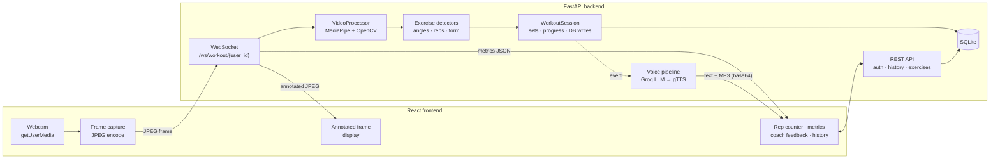

# Kinetic — React + FastAPI Migration

🔗 **Kinetic AI Gym — Project Links**
🌐 **Live Demo:**  
[]

💻 **GitHub Repository:**  
[]

🤗 **Hugging Face Backend:**  
[]


# ⚡ Kinetic — AI Gym Coach

Real-time AI workout coach that runs in your browser. Point your webcam at yourself, pick an exercise, and Kinetic tracks your body with pose estimation, counts your reps and sets, checks your form, and talks back with spoken coaching.


---

## What it does

- **Live pose tracking** — MediaPipe PoseLandmarker extracts 33 body landmarks from every webcam frame, and the skeleton is drawn on the video in real time.
- **7 supported exercises** — Squats, Push-ups, Biceps Curls, Shoulder Press, Lunges, Plank, Deadlift.
- **Automatic rep and set counting** — joint-angle state machines with EMA smoothing so jittery landmarks don't produce phantom reps.
- **Form feedback** — each exercise reports its own live metrics (depth, body alignment, swing, back arch, balance, posture) both on the video overlay and in the metrics panel.
- **AI voice coaching** — on set complete, workout complete, or lost pose, a Groq LLM writes a short coaching line and gTTS speaks it in the browser.
- **Workout planner** — choose exercise, sets, and reps (or hold-seconds for Plank) before starting.
- **Workout history** — completed sets are saved per user to SQLite and shown as a daily-aggregated table.

## Supported exercises

| Exercise | Tracked metrics | Progress counted by |
|---|---|---|
| Squats | Knee angle, back angle, depth status | Reps |
| Push-ups | Elbow angle, body alignment, hip position | Reps |
| Biceps Curls (Dumbbell) | Elbow angle, shoulder stability, swing detection | Reps |
| Shoulder Press | Elbow angle, arm extension, back arch | Reps |
| Lunges | Front-knee angle, torso angle, balance | Reps |
| Plank | Body angle, hold status, duration | Seconds held |
| Deadlift | Back angle, posture | Reps |

## How it works



**One persistent WebSocket per workout.** The browser keeps a single `<video>` element alive and streams JPEG frames to the backend. The backend runs pose estimation and draws the skeleton and overlays with OpenCV, then sends back the annotated frame plus a JSON metrics snapshot. React only updates the image and the metrics state, so the rest of the page never re-renders per frame.

**Backpressure instead of a fixed frame rate.** The client sends the next frame only after the previous annotated frame comes back, so the stream automatically runs at whatever rate the server's inference can sustain without queueing frames.

**Voice coaching never blocks video.** Groq and gTTS are network calls, so they run in a thread pool and push their result over the same socket as a separate `voice` message whenever they finish. If `GROQ_API_KEY` is missing or a call fails, voice is silently skipped and the workout keeps going.

## Tech stack

| Layer | Tools |
|---|---|
| Frontend | React 19, Vite, native `fetch` + `WebSocket` (no extra runtime dependencies) |
| Backend | FastAPI, Uvicorn, WebSockets |
| Computer vision | MediaPipe PoseLandmarker (`pose_landmarker_full`), OpenCV, NumPy |
| AI coaching | Groq (`llama-3.1-8b-instant`), gTTS |
| Data | SQLite, pandas (history aggregation) |
| Deployment | Docker multi-stage build, single container on port 7860 |

## Project structure

```
kinetic-gym/
├── Dockerfile
├── .dockerignore
├── backend/
│   ├── main.py                          # FastAPI app, CORS, static frontend mount
│   ├── requirements.txt
│   ├── .env.example
│   ├── logger/logger.py
│   ├── core/base_exercise.py            # Abstract detector interface
│   ├── detectors/                       # One class per exercise
│   │   ├── squat.py  pushup.py  biceps_curl.py  shoulder_press.py
│   │   └── lunges.py  plank.py  deadlift.py
│   ├── ml_models/pose_landmarker_full.task
│   ├── services/
│   │   ├── config/workout_config.py     # Exercise list, metric fields, skeleton connections
│   │   ├── cv_implementation/
│   │   │   ├── frame_processor.py       # EMA angle smoothing
│   │   │   └── exercise_video_processor.py   # MediaPipe + detectors + OpenCV drawing
│   │   ├── persistence/exercise_repository.py # SQLite users + workout history
│   │   ├── coaching/                    # llm.py (Groq) · tts.py (gTTS) · voice_pipeline.py
│   │   └── session_state/workout_session.py   # Per-connection sets/reps/progress
│   └── routes/                          # auth.py · history.py · ws_video.py
└── frontend/
    ├── package.json  vite.config.js  index.html
    └── src/
        ├── main.jsx  App.jsx  index.css
        ├── api/client.js
        ├── context/UserContext.jsx
        └── components/
            ├── LoginScreen  AppHeader  CoachFeedback  WorkoutEmptyState
            ├── WorkoutPlanner  ActiveWorkoutSession
            └── WorkoutStream  WorkoutMetrics  WorkoutHistory
```

## Getting started

### Prerequisites

- Python 3.11
- Node.js 20+
- A webcam
- _(Optional)_ a [Groq API key](https://console.groq.com) for voice coaching

### 1. Backend

```bash
cd backend
python -m venv venv
source venv/bin/activate          # Windows: venv\Scripts\activate
pip install -r requirements.txt
cp .env.example .env              # then add your GROQ_API_KEY (optional)
uvicorn main:app --reload --port 8000
```

### 2. Frontend

```bash
cd frontend
npm install
echo "VITE_API_BASE=http://localhost:8000" > .env
npm run dev
```

Open **http://localhost:5173**, enter a username, allow camera access, pick an exercise, and hit **Start Workout Session**.

### Environment variables

| Variable | Where | Purpose |
|---|---|---|
| `GROQ_API_KEY` | `backend/.env` | Enables LLM voice coaching. Without it, the app works normally with no voice. |
| `CORS_ALLOWED_ORIGINS` | `backend/.env` | Comma-separated allowed origins. Defaults to the Vite dev server. |
| `VITE_API_BASE` | `frontend/.env` | Backend URL in dev. In production builds the app uses its own origin. |

## Docker

The Dockerfile builds the React app and serves it from FastAPI, so the whole app runs as one container on one port.

```bash
docker build -t kinetic-gym .
docker run -p 7860:7860 -e GROQ_API_KEY=your_key kinetic-gym
```

Open **http://localhost:7860**.

### Hugging Face Spaces

1. Create a new Space with **SDK: Docker**.
2. Push this repository to it.
3. Add `GROQ_API_KEY` under the Space's secrets (optional).
4. The Space README needs this front matter so HF routes traffic to the right port:

```yaml
---
title: Kinetic AI Gym Coach
sdk: docker
app_port: 7860
---
```

Browsers only allow webcam access on HTTPS or localhost, which Spaces provides.

## API reference

### REST

| Method | Endpoint | Description |
|---|---|---|
| `POST` | `/api/auth/login` | Body `{ "username": "..." }`. Gets or creates the user, returns `{ user_id, username }`. |
| `GET` | `/api/exercise-options` | List of supported exercises. |
| `GET` | `/api/history/{user_id}` | Workout history, aggregated per exercise per day. |
| `GET` | `/api/health` | Health check. |

### WebSocket — `/ws/workout/{user_id}`

**Client → server**

| Frame | Payload |
|---|---|
| Text | `{"type": "start_workout", "exercise": "Squats", "target_sets": 3, "reps_per_set": 10}` |
| Text | `{"type": "end_workout"}` |
| Text | `{"type": "set_exercise", "exercise": "Push-ups"}` |
| Binary | One JPEG-encoded webcam frame |

**Server → client**

| Frame | Payload |
|---|---|
| Binary | Annotated JPEG (skeleton and overlays already drawn) |
| Text | Session snapshot: `exercise_type`, `reps`, `sets_completed`, `current_set_reps`, `pose_detected`, plus the exercise's live angles and statuses |
| Text | `{"type": "voice", "event": "set_complete", "text": "...", "audio_base64": "..."}` |

## Adding a new exercise

1. Create `backend/detectors/<name>.py` with a class extending `BaseExercise`. Implement `process(landmarks)` returning a metrics dict, and `reset()`.
2. Register it in `VideoProcessorClass._detectors` and add an overlay method in `exercise_video_processor.py`.
3. Add the name to `EXERCISE_OPTIONS` and its fields to `METRICS_FIELDS` in `workout_config.py`.
4. Add a metrics block for it in `frontend/src/components/WorkoutMetrics.jsx`.

## Limitations and roadmap

- **Authentication is username-only** — there is no password. Fine for a demo, not for real user data.
- **SQLite** is a good fit for a single-instance demo; concurrent heavy writes would call for Postgres.
- **Detection is rule-based.** Rep counting and form checks use joint-angle thresholds on MediaPipe landmarks, not a trained classifier, so they work best with the full body in frame and a side-on or front-on camera.
- **One pose per session** — only the first detected person is tracked.
- Ideas: password/OAuth login, per-exercise form scoring over time, progress charts on the history page, multi-language voice coaching.

## License

Add your license here (e.g. MIT).
